<!--   -->

[**Resume (PDF)**](Shrikar_CV.pdf)  |  [LinkedIn](https://linkedin.com/in/shrikar-bende)  |  [GitHub](https://github.com/ShrikarBende)  |  [Email](mailto:shrikarbende@gmail.com)

